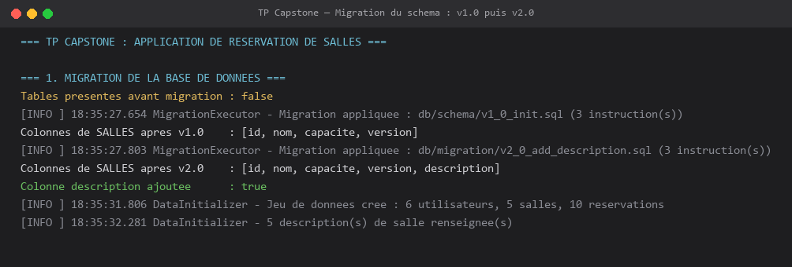
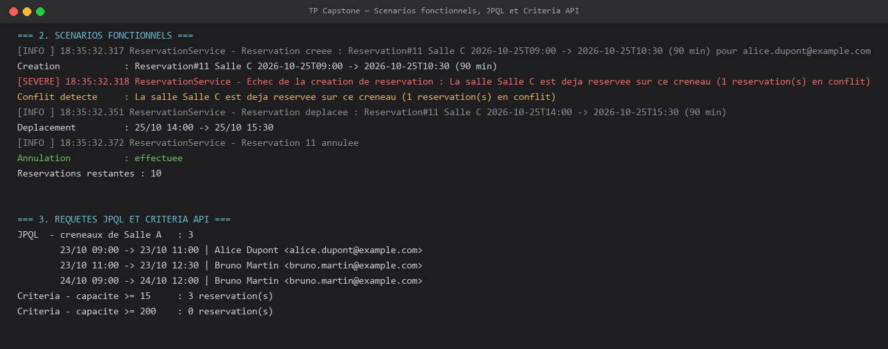
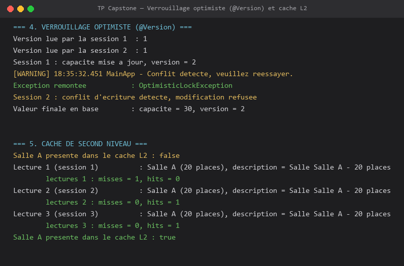
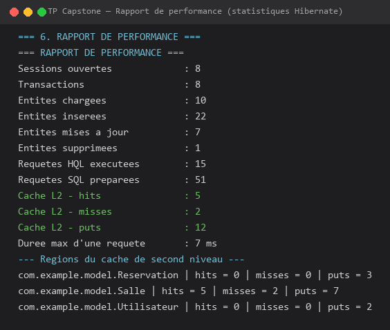

# TP Capstone — Application « Réservation de salles » avec JPA & Hibernate

Projet Maven complet correspondant au lab **« TP (Capstone) : Finaliser l'application Réservation de salles avec JPA & Hibernate »** (Hibernate & JPA).

L'application réunit tout le programme du cours : modèle JPA versionné, cache de second niveau (JCache / EhCache 3), jeu de données réaliste, tests JUnit 5, migration de schéma SQL, rapport de performance, requêtes JPQL et Criteria API, verrouillage optimiste, transactions et journalisation `java.util.logging`.

## Prérequis

- JDK 8+
- Maven 3.6+
- Aucun serveur de base de données : H2 en mémoire (`jdbc:h2:mem:reservation`)
- Aucun serveur de cache : EhCache 3 démarre dans la JVM (JCache / JSR-107)

## Structure

```
src/main/java/com/example
├── model/Utilisateur.java                 # @Cacheable + @Cache(READ_WRITE) + @Version
├── model/Salle.java                       # capacité, description (colonne migrée), @Version
├── model/Reservation.java                 # @ManyToOne(LAZY), dates, @Version, règle de chevauchement
├── service/ReservationService.java        # création, conflits, déplacement, annulation, JPQL, Criteria
├── service/ConflitReservationException.java
├── util/DatabaseConfig.java               # URL JPA/JDBC, noms des scripts de migration
├── util/MigrationExecutor.java            # exécution JDBC des scripts + introspection du schéma
├── util/DataInitializer.java              # 6 utilisateurs, 5 salles, 10 réservations
├── util/PerformanceReport.java            # statistiques Hibernate : entités, SQL, cache L2, régions
├── util/LoggingConfig.java                # java.util.logging : format court, bibliothèques muettes
└── MainApp.java                           # orchestration des 6 scénarios du capstone
src/main/resources/META-INF/persistence.xml    # unité ReservationPU (cache L2 + statistiques)
src/main/resources/ehcache.xml                 # régions EhCache 3 (expiry + heap)
src/main/resources/db/schema/v1_0_init.sql     # schéma v1.0 (utilisateurs, salles, reservations)
src/main/resources/db/migration/v2_0_add_description.sql   # migration v2.0
src/test/java/com/example/ReservationTest.java # 7 tests JUnit 5 sur le schéma réel migré
tools/run.bat                                  # compilation + exécution (sortie utilisée pour les captures)
tools/render_screenshots.py                    # génération des captures du README
pom.xml
```

## Exécution

```bash
mvn clean test
mvn compile exec:java -Dexec.mainClass=com.example.MainApp
```

Sous **PowerShell**, les propriétés `-D...` doivent être entre guillemets :

```powershell
mvn compile exec:java "-Dexec.mainClass=com.example.MainApp"
```

Le schéma n'est pas créé par Hibernate (`hbm2ddl.auto=validate`) : il provient des scripts SQL
`v1_0_init.sql` puis `v2_0_add_description.sql`, exécutés au démarrage par `MigrationExecutor`
et par les tests. Toute incohérence entre les entités et le schéma migré fait échouer le démarrage.

## Résultat attendu









## Point clé : migration de schéma

`v1_0_init.sql` crée les trois tables ; `v2_0_add_description.sql` ajoute la colonne
`description` de `salles` (mappée sur `Salle.description`) et deux index. L'application affiche
les colonnes de `SALLES` avant et après la migration, puis Hibernate **valide** le schéma obtenu :
la colonne `description` est bien présente et le démarrage échouerait si le mapping ne
correspondait pas au schéma migré.

## Point clé : cache de second niveau

- `hibernate.cache.use_second_level_cache=true`
- `hibernate.cache.region.factory_class=org.hibernate.cache.jcache.JCacheRegionFactory`
- `hibernate.javax.cache.provider=org.ehcache.jsr107.EhcacheCachingProvider`
- `hibernate.javax.cache.uri=ehcache.xml`
- `@Cacheable` + `@Cache(usage = CacheConcurrencyStrategy.READ_WRITE)` sur les trois entités

Le cache est vidé avant le test : la 1re lecture est un **miss** (SQL), les lectures suivantes
dans de nouvelles sessions sont des **hits** (aucune requête SQL, compteurs de statistiques).

## Point clé : verrouillage optimiste

`@Version` sur `Salle`, `Utilisateur` et `Reservation` : deux sessions lisent la même salle,
la première écrit (version 1 → 2), la seconde tente d'écrire avec une version obsolète et
reçoit une `OptimisticLockException` — la modification est refusée et la valeur en base reste
celle de la première session.

## Requêtes JPQL et Criteria API

| Besoin | Implémentation |
|---|---|
| Réservations d'une salle à venir | JPQL `SELECT r FROM Reservation r JOIN FETCH r.salle ...` |
| Filtre dynamique salle + date + capacité | Criteria API (`CriteriaBuilder`, `Join<Reservation, Salle>`) |
| Détection de conflit de créneau | JPQL avec prédicat de chevauchement `debut < :fin AND :debut < fin` |

Les deux approches renvoient le même nombre de réservations ; le test JUnit le vérifie.

## Transactions et gestion des erreurs

- Une transaction par cas d'usage (`EntityTransaction`), `rollback` systématique en cas d'erreur.
- `ConflitReservationException` (runtime) pour les chevauchements : la réservation n'est pas créée.
- `OptimisticLockException` interceptée et journalisée : `Conflit detecte, veuillez reessayer.`
- Annulation idempotente : `annulerReservation` renvoie `false` si la réservation n'existe plus.

## Bonnes pratiques

- `generate_statistics` uniquement en développement/test (coût non nul).
- `READ_WRITE` par défaut ; `READ_ONLY` pour des données de référence, `NONSTRICT_READ_WRITE` si les collisions concurrentes sont acceptables.
- Toujours valider les dates et les conflits côté service **et** en base (contraintes, index).
- Garder les scripts de migration versionnés et rejouables (`IF NOT EXISTS`, colonnes nullables au départ).
- `@ManyToOne` en `LAZY` par défaut + `JOIN FETCH` explicite pour éviter le N+1.
